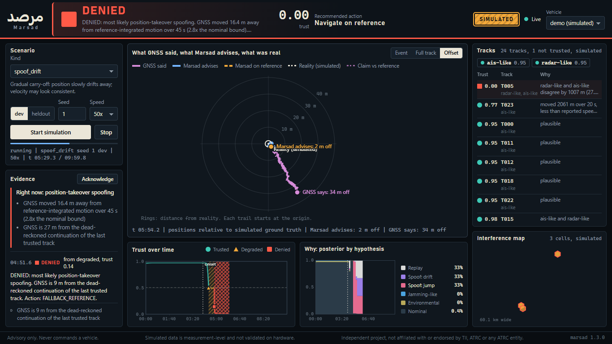

# Marsad (مرصد)

Position trust for vehicles and for tracks. Marsad takes a GNSS stream and an independent motion reference, decides
whether the position can be believed, separates a degraded signal from a false one, and recommends what to do next.

[](https://github.com/hudasol/marsad/actions/workflows/ci.yml)
Apache-2.0 · Python 3.10+ · version 1.4.0 · [changelog](CHANGELOG.md)


<sub>Operator dashboard during a SIMULATED carry off: what GNSS reported (orchid), what Marsad advises (blue, orange
while it advises the reference), what was true (white).</sub>

> Marsad is an independent open source project. It is not affiliated with or endorsed by EDGE Group, the Technology
> Innovation Institute or the Advanced Technology Research Council.

## Problem

An autopilot gates GNSS against its own filter, and a filter absorbs slow drift as real motion. A spoofer that moves
the position at a fraction of a metre per second therefore never trips the check. Navigation without GNSS exists. The
missing piece is the layer that decides when to switch to it, and, one level up, a way for a decision platform to stop
inheriting positions it cannot trust.

## What it does

| module | for | output |
|---|---|---|
| vehicle trust | autopilots, companion computers, robots | trust score, `TRUSTED / DEGRADED / DENIED`, recommended action, fallback position, evidence |
| track trust | decision support, C2, agents | per track and per source trust with reasons |
| interference map | mission planning | hex binned, time decayed confidence as GeoJSON |
| MCP server | AI agents | `assess_vehicle_window`, `score_track`, `list_distrusted_tracks`, `explain_state` |

The core engine uses only the standard library. Interfaces: PX4 ULog, MAVLink (advisory output only), ROS 2, a REST and
SSE service with a dashboard, and the MCP server.

## Results

Every number carries one label. SIMULATED is a measurement level generator; the table uses held out seeds 5000 to 5029.
SIH + INJECTED is an attack added to a real PX4 software in the loop log, scored against simulator truth. REAL LOG is a
public flight with no attack. SITL FAULT is not scored. What is and is not shown is in
[docs/VALIDATION.md](docs/VALIDATION.md).

### Against reference detectors (SIMULATED, held out, 30 seeds per scenario)

Share of runs detected, median latency in seconds. The baselines are described in [docs/BASELINES.md](docs/BASELINES.md).

| scenario | Marsad | EKF2 style gate + reference | window consistency | signal monitor |
|---|---|---|---|---|
| position jump | 100% / 0.1 | 100% / 0.1 | 100% / 0.1 | 87% / 5.5 |
| replay | 100% / 0.1 | 100% / 0.1 | 100% / 0.1 | 27% / 0.5 |
| carry off drift | 100% / 27.1 | 53% / 24.2 | 100% / 22.6 | 0% |
| stealth carry off | 100% / 58.0 | 0% | 100% / 43.0 | 0% |
| carry off, reference outage | 100% / 41.1 | 43% / 53.5 | 100% / 53.7 | 0% |
| carry off, no reference | 53% / 33.1 | 27% / 22.8 | 87% / 31.1 | 0% |
| hard jamming | 100% / 2.4 | 100% / 8.0 | 100% / 8.0 | 100% / 0.7 |

| | Marsad | EKF2 style gate + reference | window consistency | signal monitor |
|---|---|---|---|---|
| position error after a jump (median of max, m) | **8** | 430 | 430 | 430 |
| position error after replay (m) | **10** | 711 | 164 | 712 |
| nominal runs with any alarm | 0% | 0% | 23% | 0% |
| multipath runs with any alarm | 3% | 33% | 60% | 100% |

Read this table honestly: a plain window test is faster than Marsad on drift and better without a reference, but it
false alarms on nominal flights and cannot classify, and every baseline follows a jump or replay where Marsad holds
its last trusted position.

### Slow drift on real logs with an added attack (SIH + INJECTED, `sitl2.ulg`, 230 s)

| drift | Marsad | window consistency | EKF2 style gate + reference |
|---|---|---|---|
| 0.1 m/s | not detected | not detected | not detected |
| 0.25 m/s | 4/4, 113.6 s | 4/4, 57.1 s | not detected |
| 0.5 m/s | 4/4, 42.5 s | 4/4, 31.1 s | not detected |
| 1.0 m/s | 4/4, 25.5 s | 4/4, 18.1 s | not detected |

The reference in these logs is simulator truth with no bias, which flatters every method that uses it.

### Limits

Drift of 0.1 m/s is detected by nothing here. Without an independent reference Marsad finds 53% of drifts. The SIMULATED
generator and the detectors share an author. Nothing has run on a real flight controller or on real interference
data. The full list is in [docs/KNOWN_LIMITS.md](docs/KNOWN_LIMITS.md) and the plan in [docs/ROADMAP.md](docs/ROADMAP.md).

## Install

```bash
git clone https://github.com/hudasol/marsad && cd marsad
python -m venv .venv && . .venv/bin/activate        # Windows: .venv\Scripts\activate
pip install -e ".[dev]"
pytest
```

The core needs nothing beyond the standard library. Extras: `sim` (numpy, for the simulator and benchmark), `adapters`
(pyulog and pymavlink), `api` (the service) and `mcp` (the MCP server). `dev` installs all of them with the test and
lint tools.

## Use

Command line:

```bash
marsad demo spoof_drift_stealth --seed 4          # state transitions with evidence (SIMULATED)
marsad inspect flight.ulg                         # which fields a PX4 log provides
marsad replay flight.ulg --config site.json       # score a log, optional JSON config
marsad monitor udpin:0.0.0.0:14550                # live MAVLink; --out for advisory output
marsad serve                                      # dashboard and API on http://127.0.0.1:8000
marsad mcp                                        # MCP server on stdio
marsad bench --split heldout --seeds 30           # benchmark
```

Library:

```python
from marsad import TrustEngine, preset, NavSample, GnssFix, RefMotion

engine = TrustEngine(preset("uav_multirotor"))
report = engine.update(
    NavSample(
        t=12.4,
        gnss=GnssFix(t=12.4, lat=24.45, lon=54.38, ve=8.1, vn=2.0, cn0_mean=41.0, cn0_std=3.1, n_sats=13, agc=0.31),
        ref=RefMotion(t=12.4, ve=8.0, vn=2.1),  # visual odometry, optical flow, wheel odometry
    )
)
print(report.state, report.trust, report.action, report.summary)
```

A runnable version is in [examples/](examples/). Configuration files are described in
[docs/ADAPTERS.md](docs/ADAPTERS.md).

## How it works

```
 ULog / MAVLink / ROS 2 / simulator -> adapters -> NavSample stream (GNSS fix + independent velocity reference)
                                                       |
                  signal, kinematic, inertial, timing detectors -> log likelihood evidence
                                                       |
            recursive multi hypothesis fusion (environment, jamming, jump, drift, replay)
                                                       |
      state machine (hysteresis, anchor rewind, re-acquisition checked against dead reckoning)
                                                       |
        TrustReport -> MAVLink (advisory) · ROS 2 · REST/SSE · MCP · dashboard · interference map
```

The drift detector compares the GNSS displacement over several windows with the integral of the reference velocity. It
carries a slow estimate of the reference bias, and also tests against the uncorrected integral with a fixed bound so
that the estimate cannot absorb a drift. The method and its predictions are in
[docs/research/PREREGISTRATION_PRIOR_BOUND.md](docs/research/PREREGISTRATION_PRIOR_BOUND.md).

## Reproducing the tables

```bash
python scripts/run_eval.py --out docs/results/prior_bound                    # SIMULATED tables, ablation, detectability
python scripts/run_baselines.py --marsad docs/results/prior_bound/heldout.json
python scripts/sih_inject.py sitl2.ulg --end 290 --t-attack 60 --out out.json  # SIH + INJECTED
python scripts/sih_baselines.py sitl2.ulg --end 290 --t-attack 60 --marsad out.json --out base.json
```

The `.ulg` logs are not in git. `flight1.ulg` and `flight2.ulg` are public logs from review.px4.io; `sitl1.ulg` and
`sitl2.ulg` are PX4 SIH runs made with `scripts/sitl_flight.py` and attached to the GitHub release. Checksums and
download steps are in [docs/DATA.md](docs/DATA.md). Results of earlier versions are kept under `docs/results/`.

## Documentation

[Validation](docs/VALIDATION.md) · [Baselines](docs/BASELINES.md) · [Known limits](docs/KNOWN_LIMITS.md) ·
[Roadmap](docs/ROADMAP.md) · [Evaluation](docs/EVALUATION.md) · [Technical report](docs/TECHNICAL_REPORT.md) ·
[Adapters](docs/ADAPTERS.md) · [Track trust](docs/TRACKS.md) · [API](docs/API.md) · [MCP](docs/MCP.md) ·
[Dashboard](docs/DASHBOARD.md) · [Data](docs/DATA.md) · [Index](docs/README.md) · [Contributing](CONTRIBUTING.md) ·
[Security](SECURITY.md) · [Proposal seed](docs/proposals/EDGE_PROPOSAL.md)

## Scope

Marsad is not a GNSS receiver or RF analyser, not a substitute for authenticated GNSS, not an attack tool (the
simulator works at the measurement level and there is no signal generation in this repository), and it does not
command vehicles. The MAVLink reporter emits trust values and status text only, and a test enforces that. It does not
attribute interference to any actor.

## Licence

Apache-2.0. See [LICENSE](LICENSE).
