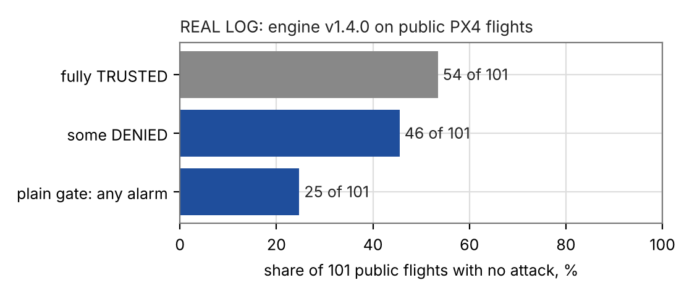
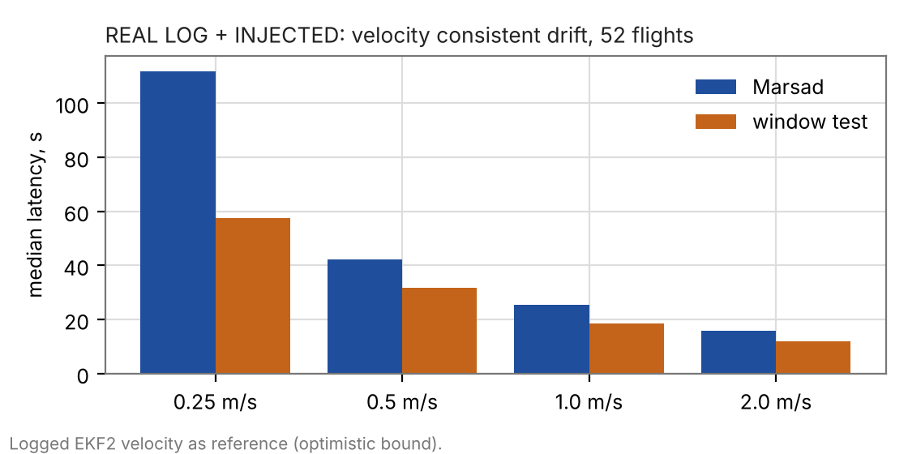

# Evidence summary (v1.5.0)

This page is the single place for what has been measured, on what, and what it does and does not support. Every number
has one label, defined in [VALIDATION.md](VALIDATION.md) before the run that produced it. Every study was preregistered
in [research/](research/) with at least one prediction that could fail, and the misses are kept. Figures in this page
that carry a hidden `claim` comment are checked against the result files by `tests/test_docs_numbers.py`.

## What the evidence supports, in one paragraph

On real public PX4 flights with no attack, the engine leaves TRUSTED on almost half of the flights, so as built it
cannot be used as an alarm without further work. When an attack is added to those flights, jumps are caught within
about half a second and drift of 0.5 m/s or more within about 20 to 40 s, but only when the reference velocity does
not follow the spoofed fixes. With PX4's own EKF2 as the reference, a velocity consistent drift is not detected at all,
by Marsad or by any baseline here, because the EKF2 is dragged along. On the 52 real flights with the optimistic reference, a plain sliding window test detected at least as many drifts as
Marsad and was 3.5 to 54 s faster at every rate. Nothing here is a test against real interference or a real attacker.

## 1. REAL LOG: public flights with no attack (engine v1.4.0)

Source: 139 logs from PX4 Flight Review, drawn by a seeded rule fixed before download; 101 scoring flights, 30 design
flights (used only for engine work), 9 with error labels reported apart (one design flight carries an error label, so the groups overlap by one). 18.5 flight hours scored. Preregistration:
[research/PREREGISTRATION_REAL_CORPUS.md](research/PREREGISTRATION_REAL_CORPUS.md). Data: [DATA.md](DATA.md).

| quantity | value |
|---|---|
| flights 100% TRUSTED | 54 of 101 (53.5%, 95% interval 43.3% to 63.5%) <!-- claim docs/results/real_corpus/summary.json R1_all_trusted/k 54 --> |
| flights with at least one DENIED sample | 46 of 101 (45.5%, interval 35.6% to 55.8%) <!-- claim docs/results/real_corpus/summary.json R2_any_denied/k 46 --> |
| alarm episodes per flight hour | 3.03 <!-- claim docs/results/real_corpus/summary.json R3_episodes_per_flight_hour 3.03 --> |
| flights with an alarm, plain gate | 25 of 101 <!-- claim docs/results/real_corpus/summary.json R5_baselines_vs_marsad/gate/flights_with_alarm/k 25 --> |
| flights with an alarm, Marsad | 47 of 101 |

Seven of seven preregistered predictions missed (R1 to R7 in the Outcome of the preregistration). The false alarm
rate is the weakest number in this project and the first one to read.

Causes. In the first alarm of the 60 alarmed flights (all strata), 46 are loss of fix, 10 are disagreement with the
reference, 3 are signal level and 1 is an AGC rise ([results/real_corpus/causes.json](results/real_corpus/causes.json)).
The loss of fix alarms are dominated by receivers at 1 Hz where one missing fix is longer than the 1.5 s timeout, and by
start up before the first stable fix. The reference in most of these logs is the EKF fused velocity, so the carry off
check is close to blind on them; this is stated, not corrected.

A trial to fix the two largest mechanisms (a timeout that follows the receiver cadence, and a recovery timer that was
cleared on ticks without a fix) improved the share of fully trusted flights from 54 to 62 of 101, missed the preregistered
target of 68, raised alarm episodes per hour from 3.03 to 4.17, and slowed some simulated spoofing detections by one
tick. It was not adopted ([research/PREREGISTRATION_CADENCE.md](research/PREREGISTRATION_CADENCE.md)). The causes were
examined on the scoring flights too, so those 62 are partly in sample.
<!-- claim docs/results/cadence_trial_real_corpus/summary.json R1_all_trusted/k 62 -->

## 2. REAL LOG + INJECTED: attacks added to real flights (engine v1.4.0)

The same flights, with an offset added to the logged fixes from a seeded onset (11 cases, 4 headings). Only flights on
which Marsad starts out trusted can be scored: of 75 eligible flights, 23 (31%) were excluded because Marsad was
already alarmed before the onset. n is 52 flights. Preregistration:
[research/PREREGISTRATION_REAL_INJECTED.md](research/PREREGISTRATION_REAL_INJECTED.md).

The reference here is the logged EKF2 velocity, computed from the uninjected fixes, which does not follow the
injected offset. This is an optimistic upper bound for every method that uses a reference. The arm with an independent
reference (optical flow, visual odometry) has 2 scored flights and is not interpreted.
<!-- claim docs/results/real_injected/summary.json arms/ekf/n_flights_scored 52 -->

| case (velocity consistent drift) | Marsad detected / median latency s | window test detected / median latency s | plain gate detected |
|---|---|---|---|
| 0.25 m/s | 45 of 52 / 111.8 | 52 of 52 / 57.6 | 2 of 52 |
| 0.5 m/s | 52 of 52 / 42.3 | 52 of 52 / 31.6 | 2 of 52 |
| 1.0 m/s | 52 of 52 / 25.5 | 52 of 52 / 18.5 | 2 of 52 |
| 2.0 m/s | 52 of 52 / 15.7 | 52 of 52 / 12.0 | 2 of 52 |

<!-- claim docs/results/real_injected/summary.json arms/ekf/cases/drift_0.25_velcons/marsad/detected 45 -->
<!-- claim docs/results/real_injected/summary.json arms/ekf/cases/drift_0.25_velcons/window/detected 52 -->
<!-- claim docs/results/real_injected/summary.json arms/ekf/cases/drift_0.25_velcons/window/median_latency_s 57.6 -->

Jumps of 50, 200 and 1000 m were detected in 52 of 52 flights by Marsad and by every baseline, median latency 0.4 to
0.5 s. Six of nine preregistered predictions hit. The two informative misses: Marsad detected 0.25 m/s drift in 87%
of flights where 50% or fewer was predicted (a better than expected result), and the window test matched its
detection and beat its latency everywhere (a worse than hoped result for Marsad). Marsad's remaining advantages are
classification and a fallback position, which this study does not measure.

## 3. SITL EKF2: PX4's own EKF2 in the loop

PX4 SITL with a patch that adds an offset to the simulated GPS (see `scripts/px4_sensor_gps_sim_offset.patch`), so that
the vehicle's own estimator fuses the spoofed fixes. 48 runs, 4 per case. Preregistration:
[research/PREREGISTRATION_SITL_EKF2.md](research/PREREGISTRATION_SITL_EKF2.md); table:
[results/sitl_ekf2/summary.md](results/sitl_ekf2/summary.md).

| case | Marsad with the EKF2 velocity as reference | Marsad with truth velocity |
|---|---|---|
| jumps 50, 200, 1000 m | 4 of 4 each, under 0.2 s | 4 of 4 |
| position only drift 0.5, 1.0, 2.0 m/s | 4 of 4, latency 62.0, 34.6, 19.4 s | 4 of 4 |
| position only drift 0.25 m/s | 0 of 4 | 4 of 4 |
| velocity consistent drift, every rate | **0 of 4** | 4 of 4 |

PX4's own EKF2 never flagged a drift as a rejected measurement over 1 s in any run (0 of 4 in every drift case), and the
plain gate and the window test also detected 0 of 4 on every velocity consistent drift. This is the study that bounds
the claim: against a spoofer whose velocity agrees with its position, and a reference that is the vehicle's own fused
estimate, nothing in this repository detects the drift. With a reference independent of the GNSS (the truth arm), all
four detect it. n = 4 per cell, one flight pattern, one PX4 build.

## 4. SIH + INJECTED: imperfect reference (engine v1.4.0)

PX4 SIH logs with the reference degraded in eight ways (plus an exact reference with no added noise, which differs from the preregistered wording) (bias, random walk, scale error, dropouts and latency). Four
flights per cell. Preregistration:
[research/PREREGISTRATION_SIH_REALISTIC_REF.md](research/PREREGISTRATION_SIH_REALISTIC_REF.md).

The engine tolerated a constant reference bias of 0.15 m/s, above the 0.08 m/s it assumes, because the estimator
absorbed it, and failed only at 0.30 m/s (false alarm in 4 of 4 flights). A scale error of 2.4% (visual odometry
figure) and a composite model with dropouts gave no false alarm in 4 flights and 4 of 4 detections at 1.0 m/s drift
(27.7 s and 28.8 s). Predictions M1, M3, M4 hit; M2 and M5 missed. With four flights these cells show only that the
tested conditions did not fail.

## 5. SIMULATED (LITERATURE): a second scenario family

Attack parameters taken from published descriptions (Tippenhauer et al. 2011, TEXBAT pages, a jammer study), with
assumed parts marked ([research/SCENARIOS_LITERATURE.md](research/SCENARIOS_LITERATURE.md)). The clean vehicle and
receiver are from the first generator, so world and engine still share an author.

Development seeds 0 to 29, 30 per kind: Marsad detected 30 of 30 on all five attack kinds with no alarm before onset, with
a false alarm in 0 of 30 nominal and 1 of 30 multipath runs. <!-- claim docs/results/literature_dev/summary.json kinds/lit_takeover/detected/marsad/k 30 -->
The family does not separate the engine from its own design: it is at the ceiling. The combined `stack` baseline was
faster than Marsad on a slow takeover (3.5 s against 10.3 s) and on a time push (7.7 s against 13.6 s).
<!-- claim docs/results/literature_dev/summary.json kinds/lit_takeover/median_latency_s/stack/median 3.51 -->

SEALED: seeds 7000 to 7099, 100 runs per kind, run once at the end of the release, for both families. All five literature
kinds were detected in 100 of 100 runs, the first family's attack kinds in 100 of 100 except no reference drift (57 of
100, held out 53%), nominal runs raised no alarm, and multipath runs alarmed in 5 and 6 of 100 (prediction S3, at most
5, missed by one run in the literature family). The sealed results match the development ones, so nothing suggests
fitting to the development seeds; they remain synthetic. See [research/PREREGISTRATION_LITERATURE.md](research/PREREGISTRATION_LITERATURE.md).
<!-- claim docs/results/sealed/literature/summary.json kinds/lit_takeover/detected/marsad/k 100 -->

## 6. SIMULATED (first family): the earlier benchmark

The held out table in the README (seeds 5000 to 5029) and the ablations are unchanged from v1.4.0 and are described in
[EVALUATION.md](EVALUATION.md). They come from a generator and engine written together; read them as regression tests,
not as evidence about attackers.

## What is still not shown

* Any result on real interference or on a real attacker's signal.
* Any flight controller in the loop other than PX4 SITL with a simulated GPS.
* Drift detection against a reference that the spoofer influences, which is the realistic case.
* Detection below 0.25 m/s, and any claim about attack at power up.
* A false alarm rate low enough for use without an operator.
* Hardware or vehicle types beyond the 87 hardware names in the scoring set (113 in the corpus); per hardware cells are one to three flights.
